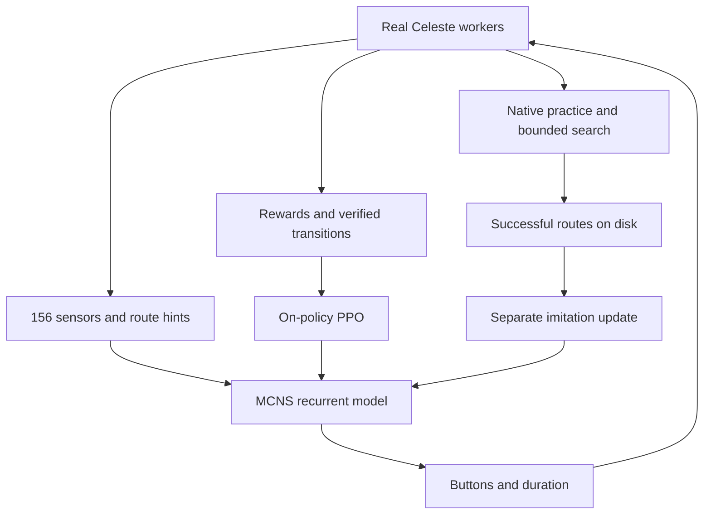

# Project architecture

I separate the launcher, game bridge, learner, and monitor so each component
has a clear responsibility. I prepare Python and start isolated Celeste workers
through the launcher. I load the compiled Everest mod in each worker and connect
through an authenticated localhost bridge. I collect policy experience, search
practice branches when enabled, update shared weights, and save. I use atomic
status snapshots for monitoring.

| File | Responsibility |
| --- | --- |
| `launch.py`, `app.py`, `.cmd` files | Environment, settings, start/stop, auxiliary tools |
| `Python/accelerator.py` | Optional tensor gradients, parity and timing-based selection |
| `Python/performance.py` | Actual controlled frames and wall/phase timings |
| `Source/SimulationPacing.cs` | Uncapped outer loop, suppressed presentation, normal manual pacing |
| `Python/protocol.py` | Version 4.1.0 / protocol 6, observations, actions, commands |
| `Python/celeste_connectome.py`, `Python/data` | Attributed selected graph and original projection |
| `Python/plastic.py` | Fly activity, edge gains, PPO/BPTT, imitation, checkpoint migration |
| `Python/learning.py` | PPO loss, duration-aware GAE, actual reward accounting |
| `Python/train.py` | Worker attempts, practice recovery, collect/update/save coordinator |
| `Python/navigation.py` | Static route field, portal selection, key/carry hints |
| `Python/search_teacher.py` | Short real-game branches; separate from PPO experience |
| `Python/experience.py`, `curriculum.py` | Persistent successful routes and attempt/evaluation records |
| `Python/workers.py`, `mod_install.py`, `scheduling.py` | Owned copies, saves, startup, resources, recovery |
| `Python/runtime.py`, `windows.py`, `monitor.py` | Lock, heartbeat, measured process identity, visibility |
| `Python/evaluate.py`, `verify.py`, `check_brain.py` | Frozen campaign test and evidence reports |
| `Python/benchmark.py`, `demonstrations.py` | Native throughput and optional verified recordings |
| `Source/FlyBrainModule.cs` | Game thread, frame stepping, chapter lifecycle, HUD |
| `Source/WorldObservation.cs`, `RoomRoute.cs` | Collision/object observations and geometric graph |
| `Source/PracticeStates.cs` | SpeedrunTool adapter, named slots, held-button state |
| `Source/BotInputs.cs`, `ButtonHistory.cs` | Held/press/release edges and binding restoration |
| `Source/RenderControl.cs` | Skip hidden-worker drawing while preserving physics stepping |
| `Source/BridgeServer.cs`, `WorkerControl.cs`, `GameAccess.cs` | Bounded protocol, controls, isolated save APIs |
| `Tests`, `tools` | Offline checks and release packaging |

I give each game private neuron activity and action RNG while sharing learned
arrays. I apply weight changes after current rollouts finish so games never
read partially updated parameters. I train teacher experience with a separate
imitation objective and never assign it fabricated PPO sampling probabilities.

I use practice slots for room entry, safe progress, temporary search branches,
and a return state for room evaluation. I delegate native level restoration to
SpeedrunTool, restore input edge history, and reconstruct neural memory from
the saved observation prefix using current weights. I check observable
physics/inventory invariants and disable practice on a mismatch.

I restrict game-state access to the game thread and check versions, tokens,
action/slot ranges, bounded queues, and finite values at the bridge. I enable
worker control through launcher environment variables and leave ordinary
Celeste outside bot control. I validate the effective Everest save path.

SHOW/HIDE uses owned PID, executable path, and creation time. Hidden workers
skip mod-level drawing while gameplay remains frame stepped. This is an
optimization in the native game, not a headless replacement or measured GPU
speedup. Hardware limits and failed worker starts remain visible.

I base routing on coarse geometry and observed objects. Terminal names, portal
reachability, and puzzle hints are approximate; only actual game transitions
and completion events count as success. See [research notes](RESEARCH.md).
